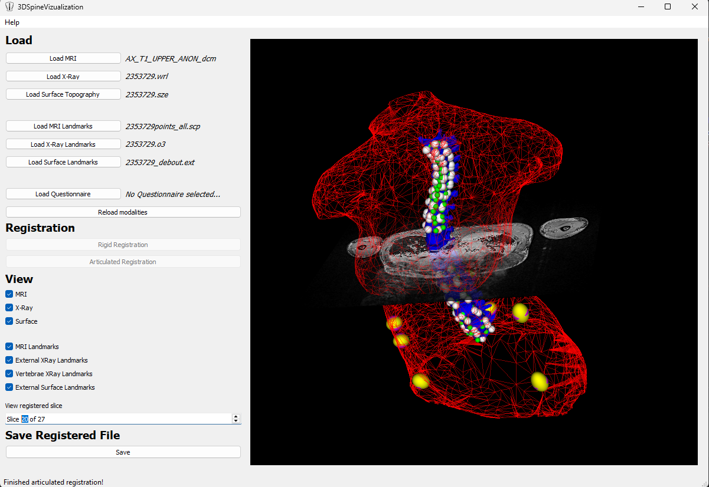
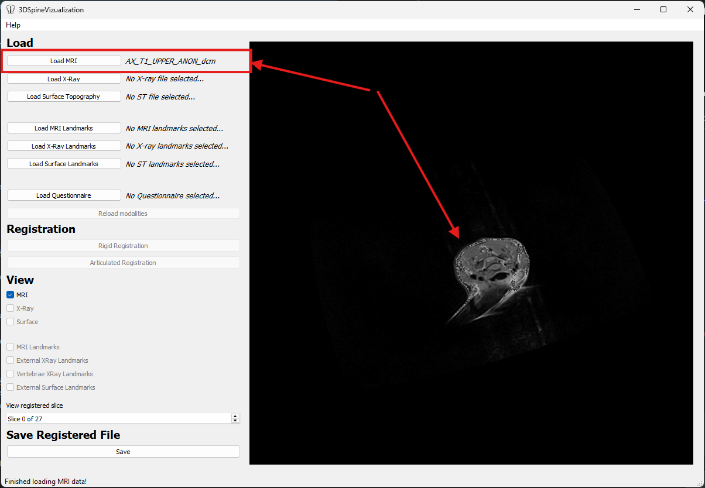
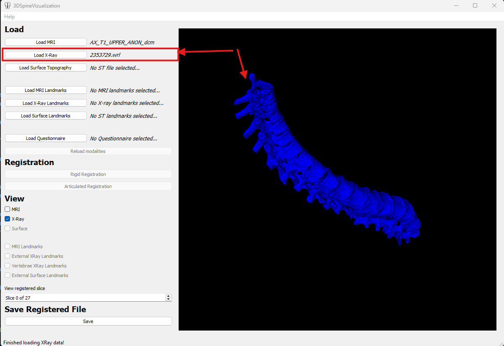
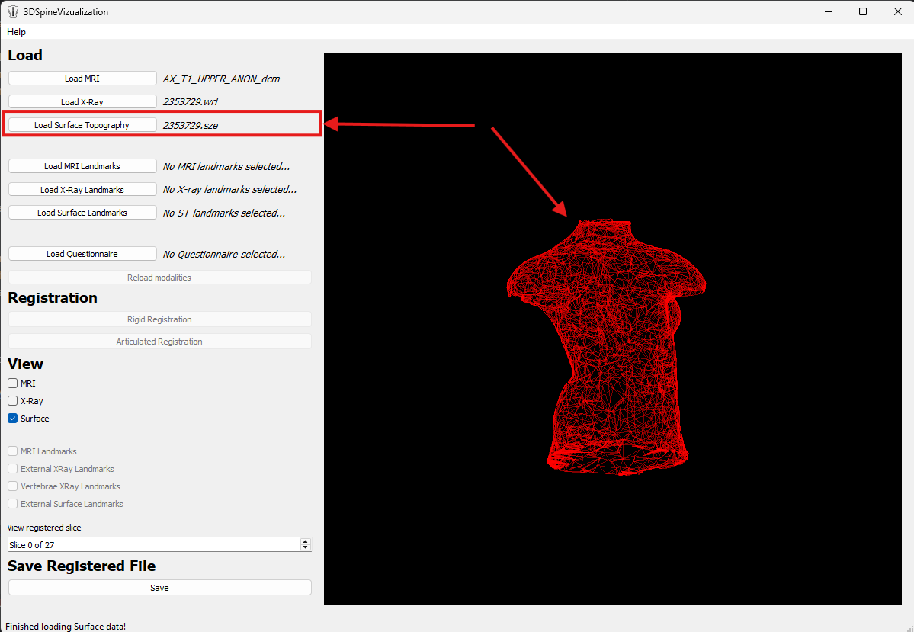
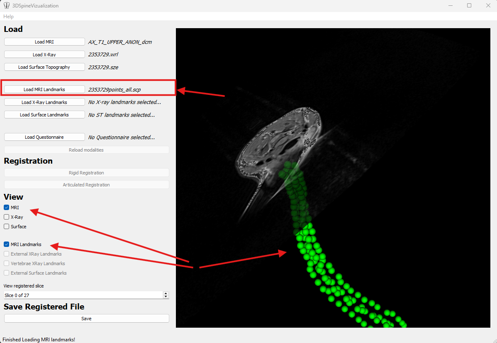
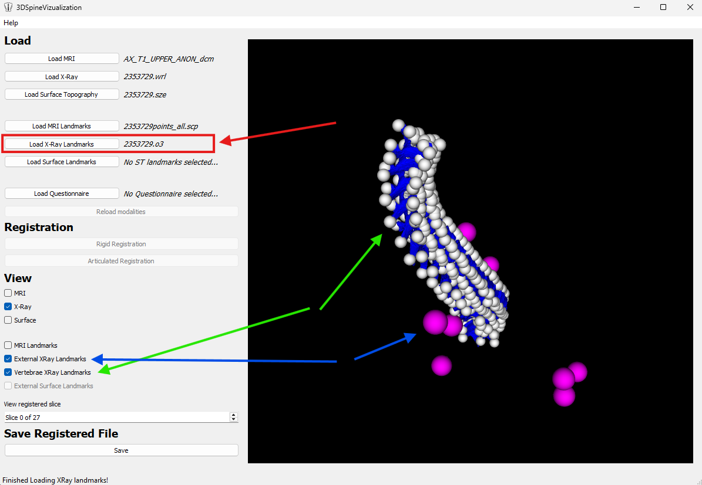
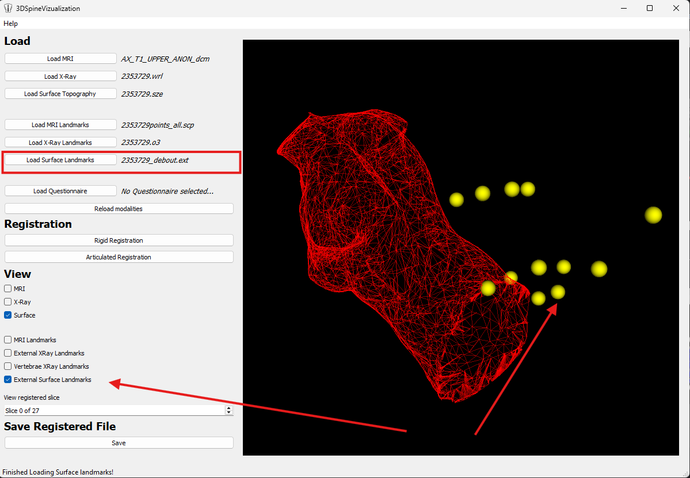
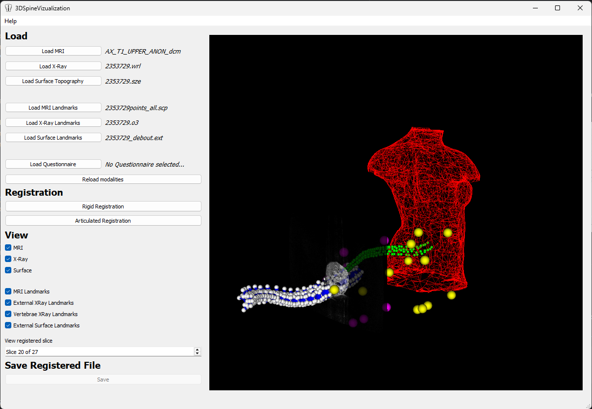
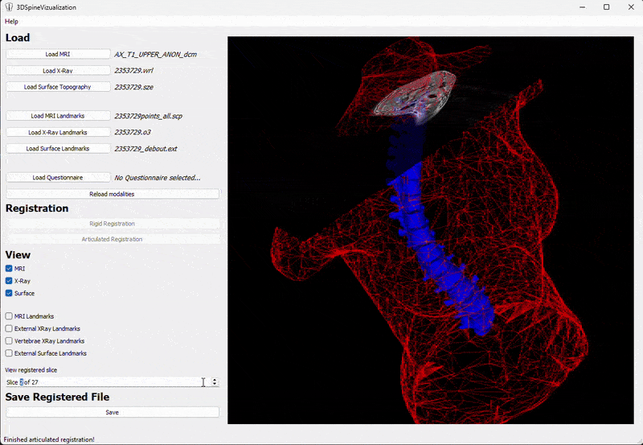
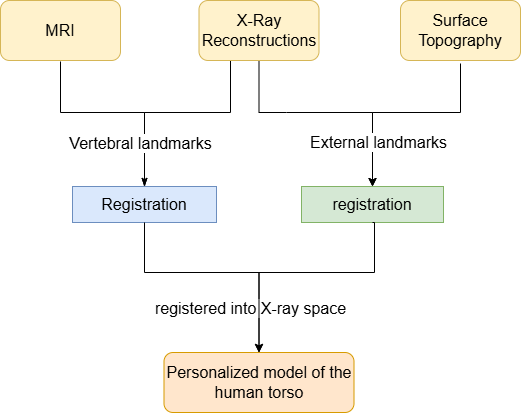

# Multimodal Image Fusion for the Reconstruction of a Human Torso

**By The-Luan Tran & Abdullah Sumbal**

This repository contains the source code for our Capstone Project: a PyQt5/VTK-based desktop application for visualizing and registering multimodal medical imaging data (MRI, X-Ray, and Surface Topography) to create comprehensive 3D models of the human torso for scoliosis surgical planning.


*Main application interface showing registered 3D torso model*

# Overview 

The Multimodal Image Fusion for the Reconstruction of a Human Torso software is a user-friendly tool for visualizing human torso using three modalities including X-Ray, MRI and surface topography. The application allows user to load and perform registration on the modalities. This application can assist researcher to develop surgical simulator for predicting surgery outcome of scoliosis patients.

## Key Features

- Load and visualize MRI (DICOM), X-Ray (VRML), and Surface Topography (.sze) files
- Register multiple modalities using rigid or articulated registration
- Interactive 3D visualization with individual modality toggling
- Navigate through MRI slices in 3D space
- Save registered models for further analysis

## Installation
- Git
- Python 3.x

```bash
# Clone the repository
git clone https://github.com/luantran/MultimodalTorsoImageReconstruction.git

cd MultimodalTorsoImageReconstruction

# Install dependencies (ensure Python 3 and pip are installed)
pip install -r requirements.txt
```
# User Guide

## Running the application

```bash
python -m src.app.py
```
## Loading Data

### 1. **Load Individual Modalities:**
   - Click "Load MRI" and select a DICOM directory. The user can view different slices through the "View registered slice" spinner.

<p align="center">
  <br/>
  <em>Load MRI slices' directory</em>
</p>

   - Click "Load X-Ray" and select a `.wrl` file

<p align="center">
  <br/>
  <em>Load XRay file (.wrl file)</em>
</p>

   - Click "Load Surface Topography" and select a `.sze` file

<p align="center">
  <br/>
  <em>Load Surface Topology file (.sze file)</em>
</p>

### 2. **Load Landmarks:**
Landmarks are required for registration

   - Click "Load MRI Landmarks" and select a `.scp` file:
   
<p align="center">
  <br/>
  <em>Load MRI landmarks (.scp file) </em>
</p>

   - Click "Load X-Ray" and select a `.o3` file. Notice the window shows both External landmarks (pink spheres) and Vertebrae landmarks (white spheres)

<p align="center">
  <br/>
  <em>Load Xray landmarks (.o3 file)</em>
</p>

   - Click "Load Surface Topography" and select a `.sze` file. The landmarks are shown as yellow spheres.

<p align="center">
  <br/>
  <em>Load Surface topology landmarks (.ext file)</em>
</p>


3. **Quick Load (Recommended for Testing):**
   - Prepare a CSV questionnaire with file paths
   - Click "Load Questionnaire" to load all modalities at once

### 3. Registration

1. Ensure all modalities and landmarks are loaded
2. Click either:
   - **Rigid Registration** - Linear transformation (faster)
   - **Articulated Registration** - Thin plate spline transformation (more accurate)
3. View the registered model in the 3D render window

<table>
  <tr>
    <td width="50%">
      
      <p align="center"><b>Before Registration</b></p>
    </td>
    <td width="50%">
      
      <p align="center"><b>After Registration</b></p>
    </td>
  </tr>
</table>

### 4. Visualization

**View Controls:**
- Check/uncheck modality boxes to toggle visibility (MRI, X-Ray, Surface)
- Check/uncheck landmark boxes to show/hide landmark points
- Use "View registered slice" spinner to navigate through MRI slices (0 to max slices)

<p align="center">
  
  <br/>
  <em>Navigating through MRI slices in the registered 3D model</em>
</p>

**3D Interaction:**
- **Rotate:** Left-click and drag / or CTRL + click and drag
- **Zoom:** Mouse wheel or right-click and drag
- **Pan:** Middle-click and drag / or SHIFT + click and drag

<p align="center">
  
  <br/>
  <em>UI 3D interactions</em>
</p>

### Saving Results

- Click "Save" under "Save Registered File"
- Select destination folder
- Registered surface topography is saved as `registered.sze`

### Reloading

- Click "Reload modalities" to reset the application and start a new session

## File Formats

| Modality | Format | Extension | Description |
|----------|--------|-----------|-------------|
| X-Ray | VRML | `.wrl` | 3D spine reconstruction mesh |
| MRI | DICOM | `.dcm`, `.ima` | Soft tissue slices (directory) |
| Surface Topography | Inspeck | `.sze` | External torso surface mesh |
| X-Ray Landmarks | Custom | `.o3` | External & vertebral landmarks |
| MRI Landmarks | Custom | `.scp` | Vertebral landmarks |
| Surface Landmarks | Custom | `.ext` | External landmarks |

## Architecture

The application follows a Model-View-Controller (MVC) architecture:

- **Model:** Reader classes (WRLReader, MRIReader, SZEReader) and Registration classes (RigidRegistration, ArticulatedRegistration)
- **View:** PyQt5-based GUI with embedded VTK render window
- **Controller:** Mediates between Model and View, handles user events

## Registration Process:

<p align="center">
  
  <br/>
  <em>Registration process</em>
</p>

## Known issues

The `Reload modalities` button does not completely reset the modalities and is a feature to be implemented correctly later.

## Authors

- Muhammad Abdullah Sumbal
- The-Luan Tran

**Supervisors:** Prof. Frank Ferrie & Dr. Rola Harmouche

**Affiliation:** McGill University, Department of Electrical and Computer Engineering

## License

MIT License - See project documentation for details. Note: Registration algorithms and data reading processes are copyright of Dr. Rola Harmouche and École Polytechnique de Montréal.

## Acknowledgments

Special thanks to Dr. Rola Harmouche for supervision, LIV4D lab at École Polytechnique Montreal for providing medical imaging data and documentation, and the Artificial Perception Lab at McGill for workspace.

## Citation

If you use this software in your research, please cite:
```
Harmouche, R., Cheriet, F., Labelle, H., & Dansereau, J. (2013). 
Multimodal image registration of the scoliotic torso for surgical planning. 
BMC Medical Imaging, 13(1). https://doi.org/10.1186/1471-2342-13-1